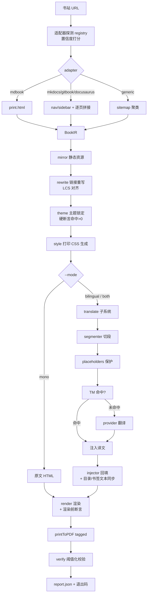

# book-site-to-pdf v2 设计规格

- 日期：2026-09-27
- 状态：**待评审**（评审通过后进入 writing-plans）
- 范围：把 `~/.agent-skills/book-site-to-pdf/`（单文件 459 行）重构为分层可扩展工具，并新增译文子系统
- 方法：superpowers 架构路径（头脑风暴 → 规格 → 实施计划 → TDD）

---

## 0. 摘要

v1 只能处理 mdBook，且存在 5 处**静默失败**（报告成功但产物是坏的）。v2 做三件事：

1. **泛化**：引入适配器层，自动识别 mdBook / MkDocs / GitBook / Docusaurus，统一为一份中间表示（IR），下游全部复用。
2. **新增译文子系统**：多语言可插拔（`--target-lang en,ja`），DOM 段级翻译，带占位符守恒校验、翻译记忆（TM）、术语表强制；支持纯译文与双语对照两种产物。
3. **把静默失败改成 fail loud**：每一处降级都变成「计数器 + 阈值 + 退出码」，坏产物必须报错。

v1 已验证的四个坑（主题被 JS 覆盖 / 双重分页 / Mermaid 裁切 / `tagged` 缺失）**全部保留为回归基线**，其行为不得改变。

---

## 1. 意图与成功判据

### 1.1 意图（已与用户确认）

| 维度 | 决定 |
|---|---|
| 方案 | **A · 分层适配器 + DOM 级译文子系统** |
| 源范围 | **自动探测多类书站**：mdBook / MkDocs / GitBook / Docusaurus（+ generic 兜底） |
| 译文方向 | **多语言可插拔**，语言对不写死；先落地中→英、中→日 |
| 翻译引擎 | 默认**本地代理**（OpenAI 兼容），可插拔到 openai / anthropic / null |
| 译文形态 | **两种都要，可切换**：纯译文 PDF、双语对照 PDF |
| 翻译范围 | 标题 + 正文段落 + 列表 + 表格文字 + 图（Mermaid）节点标签；**代码块与代码注释保持原样** |
| 交付边界 | 先出规格 → 用户确认 → 再实现 |

### 1.2 成功判据

1. 对已验证的这本书，v2 产出与 v1 **逐项等值**：1825 页 / 4212 条书签 / 7370 个页内跳转 / 0 空白页 / 0 裁切 / 0 残留相对链接。这是**回归基线**。
2. 对 MkDocs / GitBook / Docusaurus 各至少一本真站，能产出同等质量的 PDF（书签非空、页内跳转可用、无裁切）。
3. 翻译可**断点续跑**：中断后重跑，已完成段落 0 次重复 API 调用。
4. 任何一处静默降级被触发时，退出码 **≠ 0**，且 `report.json` 指出具体位置。
5. 每条校验判据都有**负样本**证明它会在坏输入下 FAIL。

---

## 2. 现状体检（v1 的靶子）

逐行读完 `scripts/book2pdf.py`（459 行）后的结论：

| 类别 | 编号 | 缺陷 | 后果 |
|---|---|---|---|
| **A 静默失败** | A1 | `default_light_theme` 用字符串精确替换，站点改名/换主题 → 命中 0 次不报错 | 白底浅灰字，正文几乎不可见，但流程"成功" |
| | A2 | `toc-*.js` 缺失 → `toc=[]` → `K=0` | 所有跨章链接退化为外网 URL（点了跳浏览器），只打一行日志 |
| | A3 | Mermaid 等待循环超时后只 `break` | 图可能整批空白，无任何报错 |
| | A4 | `<main>` 正则匹配不到 → 把整页 HTML 当 body | 链接重写范围错误，无警告 |
| | A5 | `norm()` 里硬编码了这本书的 7 个中文括注（`（技能）`/`（工作流）`…） | 换任何一本书，K 对齐精度退化 |
| **B 泛化不足** | B1 | 只有 mdBook 一条路径（`print.html` + `toc-*.js` + `navy` + `<main>`） | 换 MkDocs / GitBook / Docusaurus 直接失效 |
| | B2 | 主题只处理 `navy`，未覆盖 `coal` / `ayu` / `rust` | 换主题的站仍是深色 |
| | B3 | 容器选择器写死 `<main>`（MkDocs 是 `.md-content__inner`，Docusaurus 是 `article`） | 正文抽取为空或含导航 |
| | B4 | 镜像只跟 `href`/`src`，无 CDN 白名单 | 字体/图标漏抓，PDF 里字形缺失 |
| **C 工程性** | C1 | 459 行单文件，5 个职责纠缠 | 不可单测；改一处怕碰坏别处 |
| | C2 | 无断点 | 8 分钟渲染失败就全量重来 |
| | C3 | 端口硬编码 8765 | 被占用即崩 |
| | C4 | `__MAXH__` 靠字符串替换注入 CSS | 脆弱、不可读 |
| | C5 | 目录页只到 h2，而书签有 5 级 | 目录页信息量远小于书签 |
| | C6 | 无 PDF 元数据（title / author / lang） | 译本的语言标记缺失，屏幕阅读器按中文读英文 |
| **D 能力缺失** | D1 | 无译文 | — |
| | D2 | 无术语一致性保障 | 同一术语前后译法不一 |
| | D3 | 外链图片在 PDF 里可能空白 | 图丢失 |

---

## 3. 目标与非目标

### 3.1 目标（本版做）

- 适配器层：4 类源 + generic 兜底，**按置信度打分自动选**，可 `--adapter` 强制覆盖
- 译文子系统：段级翻译 + 占位符守恒 + TM + 术语表 + 双语/纯译两种产物
- fail loud：所有降级计数化、阈值化、退出码化，产出 `report.json`
- 断点续跑：阶段级 + 段级（翻译）
- 参数化版面：纸张、图高、目录深度、页脚
- PDF 元数据 + `<html lang>` 随译文语言同步
- 零脚本回归：mdBook 路径必须与 v1 逐项等值

### 3.2 非目标（明确不做，YAGNI）

| 不做 | 理由 |
|---|---|
| YAML 插件 DSL | 只有 5 类源，枚举足够；引入 DSL 带来抽象泄漏与调试成本 |
| EPUB / MOBI 输出 | 未被要求 |
| 扫描件 OCR / 原生 PDF 输入 | 「适合任意场景」的边界是**网页书站**，不是任意文档 |
| 自建翻译质量评分模型 | 与 `llm2jev` 是另一条独立能力，不在本轮 |
| 细粒度渲染缓存（单图级） | 只做阶段级断点；收益不成比例 |
| 图内文字默认翻译 | 见 §6.7 的量化结论——占全量 1.4% 却带来语法破坏风险，默认**关闭**，改用 `--translate-mermaid` 显式开启 |

---

## 4. 架构

### 4.1 分层

```
输入（书站 URL / 本地目录）
   │
   ▼
① 适配器探测层   registry.detect() → 置信度打分 → 选定 adapter
   │              mdBook │ MkDocs │ GitBook │ Docusaurus │ generic
   ▼  统一为 IR
② 中间表示 IR    MergedHTML + TOC + Chapters + Container + ThemePatches + Assets
   │
   ├─► 链接重写      跨章链接 → 页内锚点（LCS 对齐，支持 M 个插入点）
   ├─► 主题锁定      多主题 + 硬断言（命中 0 次即 FAIL）
   ├─► 样式注入      参数化打印 CSS（程序生成，非字符串替换）
   └─► 译文子系统    DOM 段级 → 占位符保护 → TM → provider → 回填 + 文本三处同步
   │
   ▼
③ 渲染层         Playwright + Edge：渲染前断言 → 资源/Mermaid/MathJax 等待 → printToPDF(tagged)
   │
   ▼
④ 校验层         report.json + 退出码（0/1/2/3）+ 负样本对偶测试
```

### 4.2 模块布局

```
book-site-to-pdf/
├── SKILL.md                      # 变薄：只留触发条件、一键用法、四坑速查
├── references/
│   ├── traps.md                  # 四个坑的完整机理与验证方法（自 SKILL.md 迁出）
│   ├── adapters.md               # 各站探测特征与抽取契约
│   └── translation.md            # 译文子系统：保护规则、TM 格式、术语表写法
└── scripts/
    ├── book2pdf.py               # 薄壳 CLI（~80 行，只做参数解析与编排）
    └── book2pdf/
        ├── __init__.py
        ├── config.py             # 配置合并：CLI > 配置文件 > 默认值
        ├── ir.py                 # BookIR / TocEntry / Chapter 数据类
        ├── adapters/
        │   ├── base.py           # SiteAdapter 协议 + SiteProbe + detect 打分基类
        │   ├── mdbook.py         # print.html 路径（已验证）
        │   ├── mkdocs.py         # nav + 逐页 article 拼接
        │   ├── gitbook.py        # sitemap / 侧栏 + 逐页
        │   ├── docusaurus.py     # sidebar 数据 + 逐页
        │   ├── generic.py        # sitemap.xml / 首页链接聚类兜底
        │   └── registry.py       # 探测顺序、置信度、强制覆盖
        ├── mirror.py             # 静态资源镜像（并发 + 重试 + CDN 白名单）
        ├── rewrite.py            # 链接重写 + LCS 对齐
        ├── theme.py              # 主题锁定（多主题 + 断言）
        ├── style.py              # 打印 CSS 生成器（参数化）
        ├── render.py             # Playwright 渲染（资源等待 + 断点）
        ├── verify.py             # 阈值化校验
        ├── report.py             # report.json 结构 + 退出码
        └── translate/
            ├── __init__.py
            ├── segmenter.py      # DOM → Segment[]（只取可翻文本节点）
            ├── placeholders.py   # 内联标签 ↔ ⟦n⟧ 的替换与守恒校验
            ├── tm.py             # 翻译记忆（哈希键 + 断点续跑）
            ├── glossary.py       # 术语表加载、prompt 注入、译后校验
            ├── injector.py       # 译文回填 + 目录/侧栏/书签文本三处同步
            └── providers/
                ├── base.py       # Provider 协议
                ├── openai_compat.py  # 覆盖本地代理 / OpenAI / DeepSeek
                ├── anthropic.py
                └── null.py       # dry-run：只产段清单，不调 API
```

### 4.3 中间表示（IR）

适配器**唯一**的产出契约。下游不得访问站点专有的东西。

```python
@dataclass
class BookIR:
    base_url: str                    # 站点根（用于兜底绝对 URL）
    source_kind: str                 # mdbook / mkdocs / gitbook / docusaurus / generic
    full_html: str                   # 完整页面 HTML（含 head 与脚本）
    container_selector: str          # 'main' / '.md-content__inner' / 'article'
    toc: list[TocEntry]              # 侧栏目录（有序）
    chapters: list[Chapter]          # 页内章节锚点（有序，与 toc 可存在偏移）
    theme_patches: list[tuple[str, str]]   # (old, new) 主题锁定补丁，命中数需 >0
    assets: list[str]                # 需镜像的资源 URL
    warnings: list[Warning]          # 降级记录，会进 report.json 并影响退出码

@dataclass
class TocEntry:
    path: str        # '05-skills/creating-skills.html'
    title: str
    level: int

@dataclass
class Chapter:
    anchor_id: str
    title: str
    level: int       # 1..3
```

### 4.4 适配器协议

```python
class SiteAdapter(Protocol):
    name: str

    def confidence(self, probe: SiteProbe) -> int:
        """0–100。registry 取最高分者；全部 <20 时退回 generic。"""

    def entry_urls(self, base: str) -> list[str]:
        """需要抓取的入口页（mdBook=['print.html']，MkDocs=sitemap 里的全部页）。"""

    def build(self, fetcher: Fetcher, base: str) -> BookIR:
        """抓取并归一化为 IR。不得抛未捕获异常，失败写进 warnings。"""

@dataclass
class SiteProbe:
    head_html: str            # 首页 HTML
    has_print: bool           # /print.html 是否 200 且体量远大于首页
    has_toc_js: bool          # mdBook 侧栏目录数据
    has_mkdocs_meta: bool     # <meta name="generator" content="mkdocs...">
    has_docusaurus_data: bool # window.__docusaurus / #__docusaurus
    has_gitbook: bool         # gitbook 版本标记
    sitemap_urls: list[str]
```

**探测打分（初始规则，实现时会以真站标定）**

| 适配器 | 强特征（+50） | 弱特征（+20） |
|---|---|---|
| mdbook | 有 `print.html` 且含 `default_light_theme` | 有 `toc-*.js` |
| mkdocs | `<meta name="generator" content="mkdocs*">` | `.md-content` / `nav.md-nav` |
| docusaurus | `__docusaurus` 数据 / `docusaurus` 注释 | `/docs/` 路径 + sidebar JSON |
| gitbook | gitbook 版本标记 | `/.gitbook/` 路径 |
| generic | sitemap.xml 可用 | 首页链接聚类成功 |

---

## 5. 数据流



**关键点**：翻译发生在**写出 HTML 之前**（离线，Python 侧），不在浏览器里做。
理由：可断点、可单测、可产出 `segments.jsonl` 供人工审查；且能复用 v1 已验证的渲染路径不变。

---

## 6. 译文子系统

### 6.1 为什么必须在 DOM 层做（而不是对纯文本做）

对纯文本做翻译会必然破坏结构。必须区分的节点：

| 节点 | 处理 |
|---|---|
| `<pre><code>` 代码块 | **不翻**（含代码注释） |
| 行内 `<code>` | **不翻**（标识符、命令、路径） |
| `href` / `src` / `id` / `class` | **不翻**（翻 `id` 会让全书 7370 个页内跳转当场全断） |
| Mermaid 语法关键字（`graph TD`、`-->`、`subgraph`） | **不翻** |
| Mermaid 节点标签（`A[文字]`、`B{文字}`、`-->|文字|`） | 可选翻（`--translate-mermaid`，默认关） |
| 标题 / 段落 / 列表项 / 表格单元格 | **翻** |
| 内联 `<a><strong><em><kbd>` | **保护后翻**（见 §6.2） |

### 6.2 分段与占位符保护

**分段（segmenter）**

1. 用 lxml 解析 `print-fixed.html`，取 `container_selector` 内的子树。
2. 遍历，产出 `Segment(text, dom_path, kind, elem_ref)`。
3. 跳过：空白、纯符号、纯数字、`pre/code` 子树、`script/style`、`.pdf-toc`（目录页**由译文重新生成**，不逐条翻）。
4. 去重键：`normalize(text)`（压缩空白）。同键段共用一次翻译结果。

**占位符协议（placeholders.py）**

把内联元素替换成 `⟦n⟧`：

```
原文:  请阅读 <a href="#x">前置知识确认</a> 后，再运行 <code>git worktree add</code>。
送翻:  请阅读 ⟦0⟧ 后，再运行 ⟦1⟧。
译文:  Read ⟦0⟧ first, then run ⟦1⟧.
回填:  Read <a href="#x">Prerequisites</a> first, then run <code>git worktree add</code>.
```

**守恒校验（硬规则）**：`set(译文中的占位符) == set(原文中的占位符)` 且每个占位符出现次数一致。
不满足 → 该段标 `placeholder_broken`，**回退为原文**并记入报告；不允许静默通过。
这是本子系统最重要的一条判据——没有它，机器翻译会悄悄吃掉内联标签，产生结构损坏的 PDF。

### 6.3 翻译记忆（TM）

```json
{
  "version": 1,
  "target_lang": "en",
  "glossary_hash": "sha256:9f2c…",
  "provider": "openai_compat:http://127.0.0.1:15721/v1:deepseek-chat",
  "entries": {
    "<sha256(normalized_source)>": { "t": "译文", "ts": 1758950000, "hits": 3 }
  }
}
```

**键必须包含**：归一化原文 ∥ 目标语言 ∥ **术语表哈希** ∥ **provider 标签**。

为什么必须含后两者：换术语表或换模型后，旧译文**不再可比**。若键里没有它们，重跑会错误复用旧译文——**这是一个新增的静默失败点**，设计时就必须堵住。

**断点续跑**：TM 即断点。`--resume` 时命中率即"已完成比例"；已命中的段落 0 次 API 调用。

### 6.4 术语表

```yaml
en:
  - src: 驾驭工程
    dst: Harness Engineering
    note: 书名，禁止意译
  - src: 技能
    dst: Skill
  - src: 前置知识确认
    dst: __KEEP__          # 保留原文，不翻译
```

三重作用：

1. **送入 prompt**：作为 system prompt 的术语约束（"以下术语必须译为…"）。
2. **译后校验**：检查每个 `src` 术语的 `dst` 是否出现在译文中；缺失 → 该段重试一次，仍缺则标 `glossary_miss` 并计入报告。
3. **保护**：`dst: __KEEP__` 的术语原样保留（用于品牌名、专有名词、代码名）。

术语表哈希进 TM 键（§6.3）。

### 6.5 Provider 抽象

```python
class Provider(Protocol):
    tag: str                                   # 进 TM 键的身份
    def translate(self, batch: list[str],
                  src_lang: str, dst_lang: str,
                  glossary: Glossary) -> list[str]: ...
```

| 实现 | 说明 |
|---|---|
| `openai_compat` | `POST {base_url}/chat/completions`。**覆盖本地代理 / OpenAI / DeepSeek / 任何 OpenAI 兼容端点** |
| `anthropic` | `POST /v1/messages` |
| `null` | dry-run：只产出 `segments.jsonl`，不调 API（用于审阅与预算） |

**默认配置**：`base_url` 从 `--base-url` > `~/.book2pdf/config.json` > 环境变量 `BOOK2PDF_BASE_URL` 读取。

> 实测：本机 `127.0.0.1:15721` **当前无监听**，`~/.codex/config.toml` 也不存在。
> 因此设计**不假设**任何代理存在——连接失败必须给出明确指引（"代理未启动；用 `--provider null` 可先审阅段清单"），而不是静默跳过翻译产出空译文。

**批处理**：多个短段合成一个请求（编号 + 分隔符），降低请求数；单段超长则单独发。
**并发**：`--concurrency`（默认 4），指数退避重试 3 次，超限记 `api_failed` 并保留段未译状态（下次 `--resume` 续跑）。
**预算闸门**：开跑前打印 `段数 / 字符 / token / 预计请求数`，未加 `--yes` 且超出 `--budget-tokens` 时**拒绝执行**。

### 6.6 两种产物

| 模式 | 做法 | 后果 |
|---|---|---|
| `mono`（默认） | 原文照旧，不翻译 | 与 v1 完全等值（回归基线） |
| `translated` | 产出**新 HTML**：文本节点替换为译文，`<html lang>` 改为目标语言 | 独立译文 PDF；页内跳转与书签按译文标题重建 |
| `bilingual` | 在 DOM 里**插节点**：段落后插 `<div class="tr">`，表格内插行内 `<span class="tr">` | 上原下译；页数与页码随之变化（预期） |
| `both` | 先做 translated，再做 bilingual（共享 TM） | 一次翻译，两份产物 |

**文本三处同步**（`injector.py` 的核心职责）：章节标题的显示文本出现在 ① 正文 `<h1>`、② 目录页 `.pdf-toc`、③ 浏览器/PDF 书签。翻译标题后必须三处一致，否则目录页链接文本与书签标题对不上。**锚点 `id` 三处都用原值**。

### 6.7 成本预算（真实测量，非估算）

在本机已镜像的这本书（93 篇 / 260 万字符 DOM / 1685 段代码 / 218 张 Mermaid）上实测：

| 指标 | 全量 | 去重后 | 结论 |
|---|---|---|---|
| 正文段数 | 38,144 | 26,839（70.4%） | TM 段命中率看着高 |
| 正文字符 | 720,287 | 649,401（90.2%） | **但字符只省 9.8%** |
| 其中汉字 | 406,134 | 368,609 | — |
| 图内文字候选 | 2,364 | 2,107（仅 1.0 万汉字） | 占全量 **1.4%** |
| **合计字符** | **743,145** | — | 汉字 416,147 + 非汉字 326,998 |
| **token（估）** | **31.7 万 ~ 42.2 万** | 28.6 万 ~ 38.1 万 | 中文按 1.3~1.7 字符/token |

**两条反直觉结论（驱动了两个设计决定）**：

1. **TM 的"去重省钱"是幻觉**。段命中 29.6%，但字符只省 9.8%——技术书重复的都是短标题，长正文几乎不重复。
   → 设计含义：TM 的价值主要在**断点续跑与幂等**，不在省钱。因此 TM 必须做，但不该以"省钱"为卖点。
2. **图内文字只占 1.4%，却要改 Mermaid 源码**（有语法破坏风险）。
   → 设计含义：`--translate-mermaid` **默认关闭**。

**口径纪律**：成本报告**同时输出字符口径与 token 口径**，并显式标注——中文 UTF-8 下 1 字符 = 3 字节，字节口径约为字符口径的 2.6~3 倍。`wc -c` 是陷阱。

---

## 7. 错误处理：fail loud

把 v1 的每一处静默降级改造成「计数器 → 阈值 → 退出码」。

| 编号 | v1 行为 | v2 行为 |
|---|---|---|
| A1 | 主题补丁命中 0 次静默继续 | 命中 0 次 → **FAIL**，提示"站点主题变量已变，请检查 `theme_patches`" |
| A2 | `toc=[]` 静默继续 | `toc` 为空 → **WARN** 并在报告写明"跨章链接将退化为外网 URL"；若 `--strict` 则 FAIL |
| A3 | Mermaid 超时只 `break` | 计算未渲染数；未渲染率 > 5% → **FAIL**；> 0 → WARN |
| A4 | `<main>` 匹配不到就用整页 | 容器选择器链 `['main', '.md-content__inner', 'article', '#content']` 逐一尝试；全失败 → **FAIL** |
| A5 | 硬编码中文括注归一化 | 改为**通用归一化**（去空白/标点/HTML 实体/全半角统一），并加**对齐质量断言**：平均相似度 < 0.6 → FAIL |
| C3 | 端口 8765 硬编码 | `--port 0` 默认自动选空闲端口 |
| C4 | `__MAXH__` 字符串替换 | CSS 由 `style.py` **程序生成**，值经参数传入 |

**新语义**：`--strict` 把全部 WARN 升级为 FAIL（进 CI 用）。`--fail-on warn|error` 控制粒度。

**退出码**

| 码 | 含义 |
|---|---|
| 0 | PASS |
| 1 | WARN（有降级，产物可用） |
| 2 | FAIL（构建阶段失败：适配/镜像/翻译） |
| 3 | FAIL（校验阶段不合格：空白页/裁切/书签空/占位符破损） |
| 4 | 环境或输入错误（URL 不可达、缺依赖、代理不可用且未显式允许降级） |

---

## 8. CLI 接口

向后兼容：v1 的 `--base / --out / --workdir / --print-path / --max-diagram-height / --port / --keep` 全部保留语义。

```bash
python book2pdf.py \
  --base https://example.github.io/book/ \
  --out  out/我的书.pdf \
  # ── 源 ──
  --adapter auto|mdbook|mkdocs|gitbook|docusaurus|generic
  --print-path print.html
  # ── 版面 ──
  --paper A4|Letter
  --max-diagram-height 880|auto      # auto = 按纸张可用高度计算
  --toc-depth 2|3
  --no-footer
  # ── 译文 ──
  --mode mono|translated|bilingual|both     # 默认 mono
  --target-lang en,ja
  --provider local|openai|anthropic|null    # local = openai_compat 指向本地代理
  --base-url http://127.0.0.1:15721/v1
  --model deepseek-chat
  --glossary glossary.yaml
  --tm out/tm.json
  --translate-mermaid / --no-translate-mermaid   # 默认 no
  --limit N                          # 试跑前 N 段
  --budget-tokens N                  # 超预算且无 --yes 则拒绝
  --concurrency 4
  # ── 工程 ──
  --workdir out/build
  --resume
  --keep
  --port 0
  --report report.json
  --strict
  --fail-on warn|error
```

配置文件 `~/.book2pdf/config.json` 提供默认值（CLI 覆盖它）。**任何密钥只从环境变量读，不落盘**。

---

## 9. 校验与对偶测试

### 9.1 校验判据（`verify.py`）

| 判据 | 阈值 |
|---|---|
| 书签非空 | `len(get_toc()) > 0` |
| 书签层级覆盖 | 至少到 h3（`--toc-depth` 相应） |
| 空白页 | `< 15` 字符的页数 == 0 |
| 图形裁切 | 绘图触底（`rect.y1 > page.height - 2 and height > 4`）页数 == 0 |
| 页内跳转 | `LINK_NAMED(=4)` 数量 > 0 且可解析目标页 |
| 残留相对链接 | 0 |
| Mermaid 渲染率 | ≥ 95% |
| 占位符守恒 | 破损段数 == 0（译文模式） |
| 术语表命中 | `glossary_miss` 数 == 0（译文模式） |
| 主题已锁定 | `html.className` 含 `light`，且不含 `navy/coal/ayu/rust` |

### 9.2 对偶测试（negative samples）

**每条判据都必须有一个负样本证明它会在坏输入下 FAIL**。只验证"通过路径"的判据不算判据。

| 判据 | 负样本构造 | 期望 |
|---|---|---|
| 主题已锁定 | 把 `default_light_theme` 改回 `navy` | FAIL |
| 无空白页 | 重新注入 `break-before: page` 占位 div | FAIL |
| 无裁切 | 去掉 `.mermaid svg { max-height }` | FAIL |
| 书签非空 | `outline=False` | FAIL |
| 链接无残留 | 跳过 `rewrite` 阶段 | FAIL |
| 占位符守恒 | 手工删掉译文里一个 `⟦n⟧` | FAIL（该段回退原文并计数） |
| TM 键含术语表版本 | 改术语表后用旧 TM | **必须不命中**（重新翻译） |
| 适配器探测 | 把 MkDocs 站当 mdBook 喂 | 置信度打分应拒绝并选对 |

**落地方式**：`tests/duality.py <判据名>` 自动构造负样本并断言 FAIL，纳入回归套件。
（沿用既有约定：验收标准本身必须先被检验。）

---

## 10. 兼容性与迁移

| 项 | 处理 |
|---|---|
| CLI | 完全向后兼容；v1 命令原样可跑 |
| 默认行为 | `--mode mono` 为默认，即 v1 行为 |
| SKILL.md | 变薄：触发条件 + 一键用法 + 四坑速查；细节迁到 `references/` |
| 四坑 | 机理与验证方法**原样保留**（迁到 `references/traps.md`），行为不得改变 |
| 同步 | 按既有硬约定：改 `~/.agent-skills/` 源端后**必须**跑 `sync.py`，绝不手工复制到产品技能目录 |

---

## 11. 实施阶段（概览；细任务由 writing-plans 产出）

| 阶段 | 内容 | 出口条件 |
|---|---|---|
| P0 | 拆包 + IR + 契约测试骨架；mdBook 适配器提取 | **v1 回归基线**：1825 页 / 4212 书签 / 7370 跳转 / 0 空白 / 0 裁切，逐项等值 |
| P1 | fail loud 改造（§7 七项）+ report.json + 退出码 | 7 个负样本全部 FAIL（§9.2） |
| P2 | 译文子系统：segmenter / placeholders / TM / glossary / null provider | `--provider null` 产出 `segments.jsonl`，段数与实测量级一致；占位符守恒负样本 FAIL |
| P3 | 真 provider（openai_compat）+ 断点续跑 + 预算闸门 | `--limit 200` 实跑通过；中断后 `--resume` 零重复调用 |
| P4 | MkDocs / GitBook / Docusaurus / generic 适配器 | 各至少一本真站产出 PASS 产物 |
| P5 | 双语模式 + 文本三处同步 + PDF 元数据 | 目录页/书签/正文标题三处文本一致；`<html lang>` 正确 |
| P6 | SKILL.md 瘦身 + references 拆分 + sync.py 分发 | `sync.py --lint` 0 错 0 警；`--check` 一致 |

---

## 12. 风险

| 风险 | 缓解 |
|---|---|
| 重构碰坏已验证的 mdBook 路径 | P0 必须先跑通回归基线才能继续；等值判定逐项比对 |
| 翻译量大、耗时长、成本不可控 | `--provider null` 先审阅；`--limit` 试跑；`--budget-tokens` 闸门；TM 断点 |
| 机器翻译破坏内联结构 | 占位符守恒**硬校验 + 回退原文**（§6.2） |
| 各站适配器探测误判 | 置信度打分 + `--adapter` 强制覆盖 + 探测负样本测试 |
| 本地代理不可用 | 明确报错与降级指引，不静默产出空译文（实测本机代理当前未启动） |
| 术语表换了却复用旧译文 | 术语表哈希进 TM 键（§6.3），并加负样本测试 |

---

## 13. 验收标准

v2 交付时必须同时满足：

1. **回归**：`--mode mono` 在已验书上产出与 v1 逐项等值。
2. **泛化**：MkDocs / GitBook / Docusaurus 各至少一本真站 PASS。
3. **译文**：中→英、中→日各跑通一次；`translated` 与 `bilingual` 两种产物都产出；术语表命中率 100%（或缺口全部计入报告）。
4. **fail loud**：§9.2 的 8 个负样本全部 FAIL。
5. **断点**：翻译中断后 `--resume` 的重复 API 调用数 == 0。
6. **规范**：`sync.py --lint` 0 错 0 警，`sync.py --check` 一致。

---

## 附：本规格的自我检查

- [x] 无 TBD / TODO / 占位符
- [x] 内部一致：§3.2 排除图内文字默认翻译 ↔ §6.7 的量化理由 ↔ §8 的 `--translate-mermaid` 默认值，三处口径一致
- [x] 范围：单一实施计划可覆盖（P0–P6 六阶段，每阶段可独立验收）
- [x] 歧义：`--mode` 四值语义已逐一定义；`local` provider 与 `openai_compat` 的关系已写明
- [x] 量化：成本数字来自本机实测（§6.7），非估算
- [x] 判据：每条校验判据都有负样本（§9.2）
